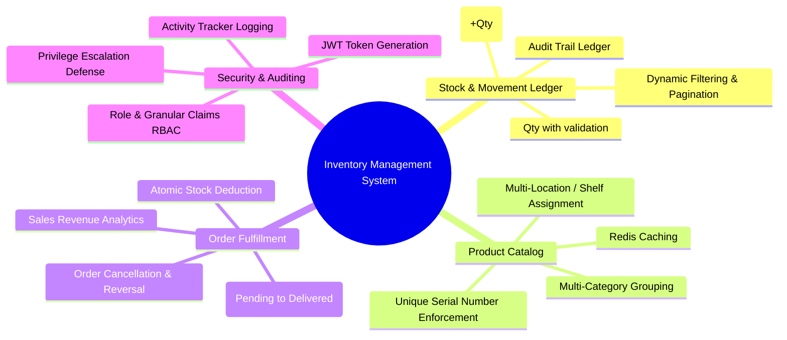
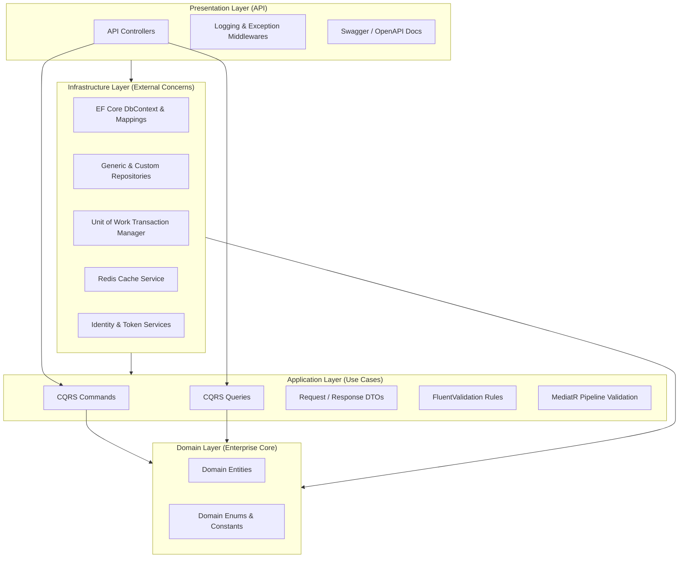
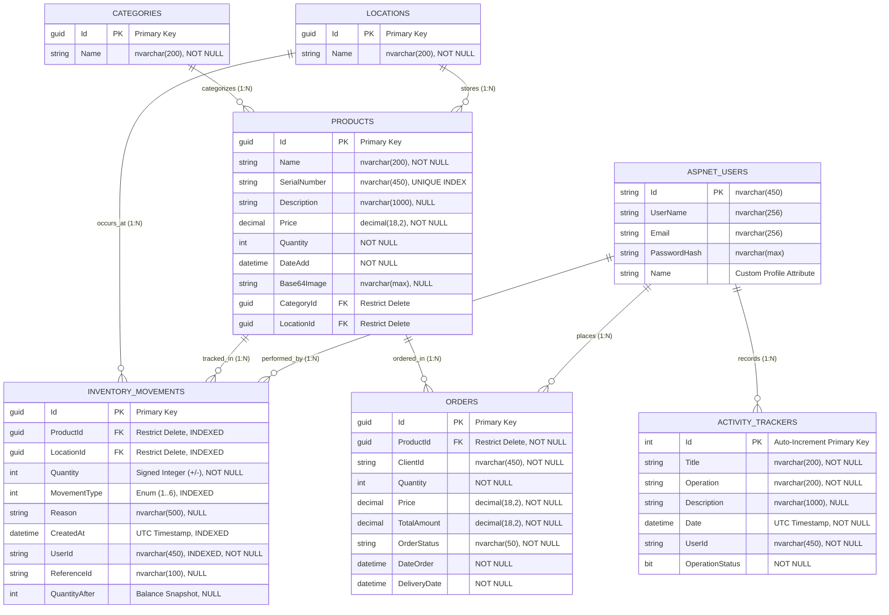

# 📦 Enterprise Inventory & Warehouse Management System

[](https://dotnet.microsoft.com/)
[](https://blog.cleancoder.com/)
[](https://github.com/jbogard/MediatR)
[](https://www.docker.com/)
[](https://redis.io/)
[](https://github.com/features/actions)
[](https://nunit.org/)
[](LICENSE)

An enterprise-grade, high-performance **Inventory & Warehouse Management Backend API** built with **C#** and **.NET 8**. Designed following **Clean Architecture (Onion Architecture)**, **CQRS (Command Query Responsibility Segregation)**, and the **Repository & Unit of Work** patterns.

The system ensures **data consistency**, **zero negative inventory**, **immutable audit logging**, and **sub-millisecond distributed caching** with Redis, backed by a production-ready **Docker** environment and **automated CI/CD pipelines**.

---

## 📌 Executive Summary (For Recruiters & Hiring Managers)

| Key Evaluation Metric | Project Implementation |
|---|---|
| **Role Target** | .NET Backend Engineer / Software Engineer |
| **Primary Framework** | C# 12, .NET 8.0, ASP.NET Core Web API |
| **Architecture Style** | Clean Architecture, CQRS, Repository & Unit of Work |
| **Data & Persistence** | EF Core 8.0 (Code-First), SQL Server 2022, Strict Foreign Key Behaviors |
| **Performance & Scale** | Distributed Caching (Redis 7) with Cache-Aside & Invalidation Strategies |
| **Security & Auth** | ASP.NET Core Identity, JWT Bearer, Dual-Layer Role & Granular Claims RBAC |
| **Testing & Quality** | NUnit, Moq, EF Core InMemory, MediatR Pipeline Validation (FluentValidation) |
| **DevOps & Containers** | Multi-stage Dockerfile, Docker Compose, GitHub Actions CI & CD Pipelines |
| **Verified Scope** | 7 Controllers, 39 RESTful Endpoints, 26 Handlers, 9 Entities & Enums |

---

## 📑 Table of Contents

- [The Business Problem It Solves](#-the-business-problem-it-solves)
- [Core Business Modules & Capabilities](#-core-business-modules--capabilities)
- [System Architecture & Design Patterns](#-system-architecture--design-patterns)
- [Database Design & ER Diagram](#-database-design--er-diagram)
- [Technology Stack](#-technology-stack)
- [Verified API Endpoints Catalog (39 Endpoints)](#-verified-api-endpoints-catalog-39-endpoints)
- [Technical Engineering Challenges & Solutions](#-technical-engineering-challenges--solutions)
- [Security & Authorization Architecture](#-security--authorization-architecture)
- [DevOps, Containerization & CI/CD](#-devops-containerization--cicd)
- [Automated Testing Suite](#-automated-testing-suite)
- [Local Setup & Quickstart Guide](#-local-setup--quickstart-guide)

---

## 🎯 The Business Problem It Solves

Traditional retail and warehouse logistics platforms frequently suffer from severe data anomalies, financial discrepancies, and operational bottlenecks:

1. **Overselling & Negative Inventory Balances:**  
   *Problem:* Concurrent orders or manual stock deductions cause stock quantities to drop below zero, leading to unfulfillable customer orders, delayed shipments, and revenue loss.  
   *Solution:* Atomic transactional deduction with pre-execution validation checks in `StockOutHandler` and `CreateOrderHandler` that immediately reject any request exceeding available stock.

2. **Absence of Audit Trails & Accountability:**  
   *Problem:* Direct updates to product quantities without recording who initiated the change, when, at which shelf location, or why.  
   *Solution:* An append-only signed movement ledger (`InventoryMovement`) capturing every stock transition (+ for StockIn, - for StockOut) with user identity, location, reason, and a post-movement balance snapshot (`QuantityAfter`).

3. **High Database Latency on Product Catalogs:**  
   *Problem:* Frequent database read queries during peak hours degrade database throughput.  
   *Solution:* Cache-Aside pattern utilizing **Redis Distributed Cache** with automatic cache eviction triggers upon any product modification or stock movement.

4. **Security Vulnerabilities & Privilege Escalation:**  
   *Problem:* Users with standard creation permissions elevating themselves or others to Administrator status.  
   *Solution:* Strict server-side role whitelisting (`AllowedCreateRoles`) preventing Admin registration via standard endpoints, combined with granular claims-based authorization.

---

## 🚀 Core Business Modules & Capabilities



### 1. Atomic Stock Movement & Ledger System
- **Stock-In Operations:** Restocks products at specific warehouse locations and generates a positive ledger entry.
- **Stock-Out Operations:** Validates available inventory before decrementing and writes a negative ledger entry.
- **Movement History & Reporting:** High-performance, paginated querying across products, locations, users, and date ranges.

### 2. Multi-Location Warehouse Organization
- Map items directly to physical storage areas, shelves, or distribution centers (`Locations`) to optimize warehouse picking routes.

### 3. Automated Order Lifecycle Management
- **Order Placement:** Automatically checks stock, calculates totals, sets estimated delivery, and reserves stock atomically.
- **Status Progression:** Tracks status through `Pending` ➔ `Processing` ➔ `Delivering` ➔ `Delivered` / `Cancelled`.
- **Advanced Sales Reporting:** Aggregates monthly revenue trends and identifies top-selling products using optimized LINQ queries.

### 4. Enterprise Identity & User Activity Auditing
- Centralized user management with ASP.NET Core Identity.
- Operational audit logging storing user actions securely derived from verified JWT token claims.

---

## 🏗️ System Architecture & Design Patterns

The project is structured according to **Clean Architecture** (Separation of Concerns), ensuring that business logic remains completely decoupled from third-party frameworks, UI, and database implementations:



### Architectural Patterns Implemented:
1. **Clean / Onion Architecture:** Domain layer has zero external dependencies; Application layer contains business rules; Infrastructure handles database and external services.
2. **CQRS with MediatR:** Strict isolation between read operations (`Queries`) and write operations (`Commands`).
3. **Pipeline Behavior Pattern:** `ValidationBehavior<TRequest, TResponse>` intercepts all requests before handlers execute, ensuring automatic schema and business validation.
4. **Repository & Unit of Work:** Decouples data access from business handlers and coordinates multi-entity transactions into single atomic database commits.
5. **Cache-Aside Pattern:** High-speed Redis memory caching with surgical key invalidation on update events.

---

## 🗄️ Database Design & ER Diagram

The database schema is designed for **referential integrity**, **auditability**, and **query optimization**. All foreign key deletions are restricted (`DeleteBehavior.Restrict`) to prevent catastrophic cascading deletions.



---

## 💻 Technology Stack

| Layer / Concern | Technology | Version | Purpose in Project |
|---|---|---|---|
| **Runtime & Language** | C# 12 / .NET | `8.0` | Modern, high-performance runtime |
| **API Framework** | ASP.NET Core Web API | `8.0` | RESTful HTTP service endpoints |
| **Data Access & ORM** | Entity Framework Core | `8.0.28` | Code-first schema, LINQ queries, migrations |
| **Database** | Microsoft SQL Server | `2022` | Relational storage with strict constraints |
| **CQRS & Messaging** | MediatR | `12.2.0` | Command and Query dispatching |
| **Validation Engine** | FluentValidation | `12.1.1` | Automatic pipeline model validation |
| **Distributed Caching**| StackExchange.Redis | `10.0.12` | In-memory distributed caching engine |
| **Identity & Security** | ASP.NET Core Identity | `8.0.28` | User management, hashing, role stores |
| **Authentication** | JWT Bearer Authentication | `8.0.0` | Token-based stateless authentication |
| **Object Mapping** | Mapster | `10.0.11` | High-performance DTO-to-Entity mapper |
| **Automated Testing** | NUnit & Moq | `4.6.1` | Unit test assertions & mock dependencies |
| **Database Testing** | EF Core InMemory | `8.0.28` | In-memory database context for test suites |
| **Containerization** | Docker & Docker Compose | Multi-Stage | Local and production multi-container setup |
| **CI/CD Automation** | GitHub Actions | Workflows | Continuous integration & container delivery |

---

## 🔌 Verified API Endpoints Catalog (39 Endpoints)

Every endpoint listed below has been verified directly against the controller action signatures:

### 1. Account & Security (`/api/account`) - 7 Endpoints
- `POST /api/account/login` - Authenticate credentials and receive signed JWT.
- `POST /api/account/create` - Admin-only endpoint for onboarding `Manager` and `User` accounts.
- `GET /api/account/users` - Admin-only user directory retrieval.
- `POST /api/account/identity/setup` - Idempotent seed endpoint for initial System Administrator setup.
- `PUT /api/account/update-claims` - Admin-only endpoint to modify role and granular claim permissions.
- `GET /api/account/activities` - Manager & Admin endpoint to review operational audit logs.
- `POST /api/account/activity` - Securely log user activity with identity pulled from token claims.

### 2. Category Catalog (`/api/category`) - 6 Endpoints
- `GET /api/category` - Retrieve all categories.
- `GET /api/category/{id}` - Retrieve single category by ID.
- `GET /api/category/with-products` - Retrieve categories with eager-loaded products.
- `POST /api/category` - Create category with duplicate name check.
- `PUT /api/category` - Update category name and properties.
- `DELETE /api/category/{id}` - Remove category with relation checks.

### 3. Inventory Operations (`/api/inventory`) - 2 Endpoints
- `POST /api/inventory/stock-in` - Add stock, record positive ledger entry, and clear Redis cache.
- `POST /api/inventory/stock-out` - Deduct stock with deficit validation, record negative ledger entry, and clear Redis cache.

### 4. Inventory Movements & Ledger (`/api/inventorymovement`) - 6 Endpoints
- `GET /api/inventorymovement` - Multi-parameter filtered & paginated search (Product, Location, Type, User, Date).
- `GET /api/inventorymovement/{id}` - Retrieve movement transaction details.
- `GET /api/inventorymovement/product/{productId}` - Chronological movement history for a specific product.
- `GET /api/inventorymovement/reports/stock-in` - Filtered report of inbound stock additions.
- `GET /api/inventorymovement/reports/stock-out` - Filtered report of outbound stock deductions.
- `GET /api/inventorymovement/reports/adjustments` - Filtered report of manual stock adjustments.

### 5. Warehouse Locations (`/api/location`) - 5 Endpoints
- `GET /api/location` - Retrieve all storage locations/shelves.
- `GET /api/location/{id}` - Retrieve location details by ID.
- `POST /api/location` - Create a new warehouse location.
- `PUT /api/location` - Update existing warehouse location.
- `DELETE /api/location/{id}` - Remove warehouse location.

### 6. Order Management & Analytics (`/api/order`) - 8 Endpoints
- `GET /api/order` - Retrieve all customer orders with relational product/client details.
- `GET /api/order/user/{userId}` - Retrieve order history for a specific customer.
- `GET /api/order/count` - Aggregated status distribution count (Pending, Delivered, Cancelled).
- `GET /api/order/monthly` - Monthly sales revenue analytics report.
- `GET /api/order/top-ordered` - Statistical query determining the best-selling product.
- `POST /api/order` - Place order with automatic inventory deduction.
- `PUT /api/order` - Update delivery schedule or order status.
- `PUT /api/order/cancel/{orderId}` - Cancel order and transition state.

### 7. Product Catalog (`/api/product`) - 5 Endpoints
- `GET /api/product` - Retrieve product catalog (Cached via Redis, 10-minute TTL).
- `GET /api/product/{id}` - Retrieve specific product with category and location.
- `POST /api/product` - Create new product with unique serial verification and purge cache.
- `PUT /api/product/{id}` - Update product details and purge affected cache keys.
- `DELETE /api/product/{id}` - Delete product and purge cache.

---

## 💡 Technical Engineering Challenges & Solutions

### 1. Atomic Stock Changes & Zero Negative Inventory
- **The Challenge:** High-frequency stock-out or order placement requests can cause race conditions or overselling if stock checks and updates occur in separate, uncoordinated steps.
- **The Solution:** In `StockOutHandler.cs`, stock availability is verified before modifying the database entity. If `product.Quantity - request.Quantity < 0`, the transaction is aborted immediately with an explicit error. When valid, the product update and `InventoryMovement` creation are committed together within `_unitOfWork.SaveChangesAsync(cancellationToken)` in a single transaction.

### 2. Cache Invalidation & Consistency (Cache-Aside Pattern)
- **The Challenge:** Storing product catalogs in Redis accelerates read operations, but write mutations (stock in, stock out, price edits) risk serving stale data to clients.
- **The Solution:** Implemented strict cache invalidation in all modifying handlers (`CreateProductHandler`, `UpdateProductHandler`, `StockInHandler`, `StockOutHandler`):
  ```csharp
  // Automatic cache eviction triggers
  await _cacheService.RemoveAsync("products:all");
  await _cacheService.RemoveAsync($"product:{product.Id}");
  ```

### 3. Privilege Escalation Defense in User Registration
- **The Challenge:** In typical systems, client requests could send arbitrary role parameters (e.g. `Role="Admin"`) during registration, potentially compromising administrative control.
- **The Solution:** A defensive server-side whitelist (`AllowedCreateRoles`) was implemented in `Account.cs` that explicitly permits only `Manager` and `User` creation via standard endpoints. Administrator initialization is strictly isolated to an idempotent bootstrap setup routine:
  ```csharp
  private static readonly HashSet<string> AllowedCreateRoles = new(StringComparer.OrdinalIgnoreCase)
  {
      Policy.RoleClaim.Manager,
      Policy.RoleClaim.User
  };
  ```

### 4. Cross-Cutting Pipeline Validation & Global Error Handling
- **The Challenge:** Controller action methods cluttered with manual `ModelState` validation checks and inconsistent error response models across endpoints.
- **The Solution:** Embedded `ValidationBehavior<TRequest, TResponse>` into the MediatR execution pipeline to automatically validate all DTOs against `FluentValidation` rules before handlers execute. A centralized `ExceptionHandlingMiddleware` intercepts exceptions, sanitizes sensitive internal messages, and serializes consistent error payloads (`ServicesResponse`).

---

## 🛡️ Security & Authorization Architecture

The system features a **Dual-Layer Authorization Matrix** combining role-based security with fine-grained claim assertions:

```text
User Identity ➔ JWT Token ➔ Role Claim ("Admin", "Manager", "User")
                          ➔ Operational Claims (create, update, delete, read, MangerUser)
```

### Authorization Policy Matrix:
| Policy Name | Required Roles / Claims | Target Operations |
|---|---|---|
| `AdminPolicy` | Role: `Admin` | User creation, role modifications, system configuration |
| `ManagerPolicy` | Role: `Admin` OR `Manager` | Order management, sales reports, activity audit logs |
| `CreatePolicy` | Role: `Admin`, `Manager` OR Claim: `create=true` | Product creation, Stock-In, Stock-Out |
| `UpdatePolicy` | Role: `Admin`, `Manager` OR Claim: `update=true` | Product updates, location and category edits |
| `DeletePolicy` | Role: `Admin` OR Claim: `delete=true` | Deleting products, categories, locations |
| `ReadPolicy` | Any Authenticated User | Browsing catalog, viewing movement history |

---

## 🚢 DevOps, Containerization & CI/CD

### 1. Multi-Container Orchestration (`docker-compose.yml`)
The repository includes a complete local development orchestration running three isolated services with native health checks:
- **`inventory-api`:** ASP.NET Core 8 Web API container running as an unprivileged secure user (`appuser`).
- **`inventory-sqlserver`:** Microsoft SQL Server 2022 with automatic health check:
  ```bash
  /opt/mssql-tools18/bin/sqlcmd -S localhost -U sa -P 'Dev@Password123!' -C -Q 'SELECT 1'
  ```
- **`inventory-redis`:** Redis 7 Alpine cache instance with automated ping health check (`redis-cli ping`).

### 2. Continuous Integration Pipeline (`.github/workflows/ci.yml`)
- Triggers automatically on push and pull-request events.
- Performs `dotnet restore`, `dotnet build -c Release`, and code style enforcement (`dotnet format`).
- Launches live SQL Server and Redis service containers in the GitHub Actions runner.
- Executes automated NUnit test suites and collects **Cobertura code coverage**.
- Conducts security audits searching for vulnerable or deprecated NuGet dependencies (`dotnet list package --vulnerable`).

### 3. Continuous Deployment Pipeline (`.github/workflows/cd.yml`)
- Gated by successful build and test completion.
- Builds an optimized multi-stage Docker image using Buildx.
- Authenticates securely with **GitHub Container Registry (`ghcr.io`)** and publishes versioned images.
- Includes pre-configured staging and production deployment steps.

---

## 🧪 Automated Testing Suite

Located under `Testing/`, the test suite verifies core business rules and edge cases using **NUnit**, **Moq**, and **EF Core InMemory Database**:

- ✅ `StockIn_IncreasesQuantity_AndCreatesPositiveMovement`: Verifies accurate balance increments and ledger creation.
- ✅ `StockOut_DecreasesQuantity_AndCreatesNegativeMovement`: Verifies stock deduction and negative quantity ledger recording.
- ✅ `StockOut_InsufficientStock_Fails_AndNoChange`: Confirms that deficit requests are blocked without corrupting inventory data.
- ✅ `GetInventoryMovements_FilterByProduct_ReturnsCorrectItems`: Validates dynamic filtering by product.
- ✅ `GetProductInventoryHistory_Pagination_Works`: Tests multi-page pagination logic and total page calculations.
- ✅ `CreateProduct_ValidRequest_ReturnsSuccess`: Validates product entity persistence and data integrity.

Execute tests via CLI:
```bash
dotnet test "Inventory Management System.slnx"
```

---

## 🚀 Local Setup & Quickstart Guide

### Prerequisites
- [.NET 8.0 SDK](https://dotnet.microsoft.com/download/dotnet/8.0)
- [Docker Desktop](https://www.docker.com/products/docker-desktop) (for containerized execution)
- [SQL Server](https://www.microsoft.com/en-us/sql-server/) & [Redis](https://redis.io/) (for bare-metal execution)

---

### Option A: Quickstart with Docker Compose (Recommended)

1. **Clone the repository:**
   ```bash
   git clone https://github.com/AhmedSaye2d/InventoryManagementSystem01.git
   cd InventoryManagementSystem01
   ```

2. **Spin up all services (API + SQL Server + Redis):**
   ```bash
   docker compose up -d
   ```

3. **Verify running containers:**
   ```bash
   docker compose ps
   ```

4. **Explore the API:**  
   Open your browser and navigate to:  
   👉 **`http://localhost:8080/swagger`**

---

### Option B: Bare-Metal Local Development

1. **Configure Connection Strings:**  
   Ensure your local SQL Server and Redis instances are running, and update `API/appsettings.Development.json`:
   ```json
   {
     "ConnectionStrings": {
       "DefaultConnection": "Server=localhost;Database=InventoryDb;Trusted_Connection=True;TrustServerCertificate=True;",
       "RedisCacheUrl": "localhost:6379"
     }
   }
   ```

2. **Apply Database Migrations:**
   ```bash
   dotnet ef database update --project Infrastructure --startup-project API
   ```

3. **Run the API:**
   ```bash
   dotnet run --project API
   ```

4. **Access Swagger UI:**  
   Open: 👉 **`https://localhost:7147/swagger`**

---

## 📄 License
This project is open-source software licensed under the [MIT License](LICENSE).
