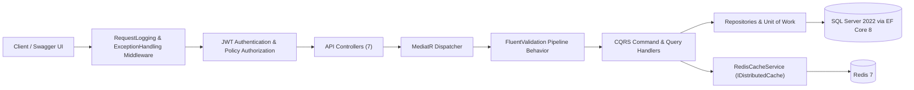
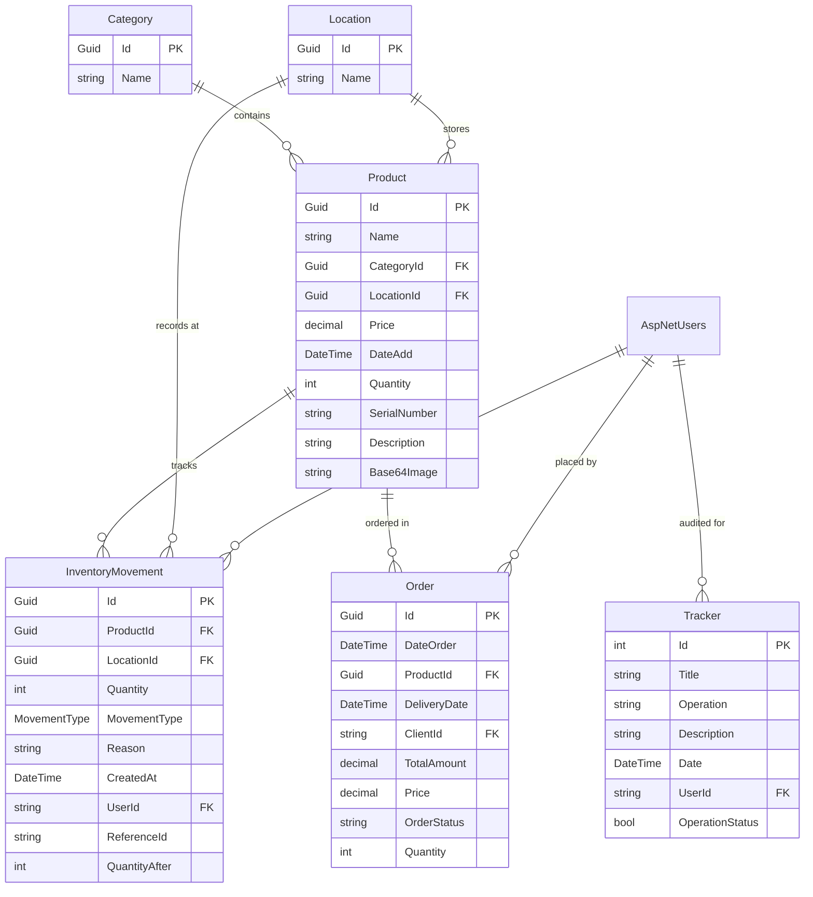

<div align="center">

# 📦 Inventory Management System API

**Enterprise-grade RESTful Backend for Real-Time Warehouse Operations, Stock Auditing & Order Fulfillment**

[](https://dotnet.microsoft.com)
[](https://learn.microsoft.com/aspnet/core)
[](https://learn.microsoft.com/ef/core)
[](https://www.microsoft.com/sql-server)
[](https://redis.io)
[](https://www.docker.com)
[](.github/workflows/ci.yml)

</div>

---

## 📋 Table of Contents

1. [Project Overview & Problem Statement](#-1-project-overview--problem-statement)
2. [Architecture & Request Pipeline](#-2-architecture--request-pipeline)
3. [Database Design (ER Diagram)](#-3-database-design-er-diagram)
4. [Tech Stack & Exact Versions](#-4-tech-stack--exact-versions)
5. [Prerequisites & Dependencies](#-5-prerequisites--dependencies)
6. [Installation & Quick Start](#-6-installation--quick-start)
7. [Environment Variables & Configuration](#-7-environment-variables--configuration)
8. [Usage, Core Features & API Reference (39 Endpoints)](#-8-usage-core-features--api-reference-39-endpoints)
9. [Security & RBAC Policy Matrix](#-9-security--rbac-policy-matrix)
10. [Testing Guide](#-10-testing-guide)
11. [Docker & CI/CD Pipelines](#-11-docker--cicd-pipelines)
12. [Project Structure](#-12-project-structure)

---

## 🎯 1. Project Overview & Problem Statement

The **Inventory Management System** is a production-oriented backend REST API built with **ASP.NET Core 8**, **Clean Architecture**, and **CQRS (MediatR)**. It provides end-to-end control over multi-location warehouse stock, immutable inventory movement logs, order processing, activity auditing, and fine-grained user permissions.

### Business Problems Solved

| Warehouse / Retail Challenge | Engineering Solution Implemented |
| :--- | :--- |
| **Negative Stock & Overselling** | Stock-out operations validate available quantity prior to deduction and reject insufficient stock atomically. |
| **Zero Auditability on Stock Changes** | Every stock-in, stock-out, adjustment, return, or relocation writes an immutable `InventoryMovement` record with signed quantity, reason, UTC timestamp, `UserId`, `ReferenceId`, and `QuantityAfter`. |
| **Slow Read Performance at Scale** | Distributed **Redis** caching (`ICacheService` / `RedisCacheService`) using `IDistributedCache` with cycle-safe JSON serialization. |
| **Unauthorized Access & Privilege Abuse** | **JWT Bearer** authentication + **ASP.NET Core Identity** backed by **8 authorization policies** combining roles (`Admin`, `Manager`) and granular claims (`create`, `update`, `delete`, `MangerUser`). |
| **Inconsistent Validation & Error Handling** | Centralized MediatR `ValidationBehavior<,>` powered by **FluentValidation**, paired with global `ExceptionHandlingMiddleware` and `RequestLoggingMiddleware`. |

### Project Snapshot

| Metric | Verified Count |
| :--- | :--- |
| **REST Controllers** | 7 Controllers |
| **API Endpoints** | 39 Endpoints (plus `/health`) |
| **Domain Models & Enums** | 9 (`Product`, `Category`, `Location`, `InventoryMovement`, `Order`, `Tracker`, `ProductBase`, `MovementType`, `OrderStatus`) |
| **Authorization Policies** | 8 Policies |
| **Unit Tests** | 10 NUnit Tests across 3 Test Fixtures |

---

## 🏛 2. Architecture & Request Pipeline

The solution enforces **Clean / Onion Architecture** dependency rules where inner layers (`Domain`, `Application`) never depend on outer implementation details (`Infrastructure`, `API`).



### Layer Responsibilities

- **`Domain`**: Core entities (`Product`, `Category`, `Location`, `InventoryMovement`, `Order`, `Tracker`), base classes (`ProductBase`), and domain constants/enums (`MovementType`, `OrderStatus`). Zero external dependencies.
- **`Application`**: CQRS Commands & Queries, DTOs, FluentValidation validators, Repository/UnitOfWork/Cache interfaces (`ICacheService`, `IUnitOfWork`), and identity extensions.
- **`Infrastructure`**: EF Core `AppDbContext`, SQL Server migrations & idempotent `AppDbSeeder`, Repository & UnitOfWork implementations, MediatR handlers, `ValidationBehavior`, `RequestLoggingMiddleware`, `ExceptionHandlingMiddleware`, JWT & Identity setup, and `RedisCacheService`.
- **`API`**: Thin REST controllers, Swagger/OpenAPI with JWT Bearer security definition, DI composition root (`Program.cs`), and `/health` endpoint.
- **`Testing`**: Isolated NUnit test suite using EF Core InMemory and Moq.

---

## 🗄 3. Database Design (ER Diagram)

The relational schema is managed via **EF Core 8 Code-First** (`AppDbContext : IdentityDbContext<ApplicationUser>`).



### Key Domain Enums & Statuses

- **`MovementType`**: `StockIn (1)`, `StockOut (2)`, `Adjustment (3)`, `Return (4)`, `RelocationIn (5)`, `RelocationOut (6)`
- **`OrderStatus`**: `Pending`, `Processing`, `Delivering`, `Delivered`, `Cancelled`

---

## 🛠 4. Tech Stack & Exact Versions

### Runtime & Web Framework

| Component | Version | Purpose |
| :--- | :--- | :--- |
| **.NET / ASP.NET Core** | `net8.0` | Cross-platform Web API runtime & host |
| **Swashbuckle.AspNetCore** | `6.6.2` | OpenAPI / Swagger UI with Bearer JWT support |

### Application & Mapping

| Package | Version | Purpose |
| :--- | :--- | :--- |
| **MediatR** | `12.2.0` | CQRS request/handler decoupling & pipeline behaviors |
| **FluentValidation.DependencyInjectionExtensions** | `12.1.1` | Declarative DTO & command validation |
| **Mapster** | `10.0.11` | High-performance object-to-object mapping |
| **NetcodeHub.Packages.Extensions.Attributes.RequiredGuid** | `1.0.0` | Non-empty GUID validation attributes |

### Data, Identity & Caching

| Package | Version | Purpose |
| :--- | :--- | :--- |
| **Microsoft.EntityFrameworkCore** | `8.0.28` | ORM & change tracking |
| **Microsoft.EntityFrameworkCore.SqlServer** | `8.0.27` | SQL Server database provider |
| **Microsoft.EntityFrameworkCore.Design / Tools** | `8.0.28` | Migrations & EF Core CLI tooling |
| **Microsoft.AspNetCore.Identity.EntityFrameworkCore** | `8.0.28` | User, role, and claim management |
| **Microsoft.AspNetCore.Authentication.JwtBearer** | `8.0.0` | Stateless JWT authentication |
| **Microsoft.Extensions.Caching.StackExchangeRedis** | `10.0.12` | Distributed Redis cache integration |

### Testing

| Package | Version | Purpose |
| :--- | :--- | :--- |
| **NUnit** | `4.6.1` | Unit test framework |
| **NUnit3TestAdapter** | `6.3.0` | Visual Studio & `dotnet test` adapter |
| **Moq** | `4.20.72` | Dependency mocking |
| **Microsoft.EntityFrameworkCore.InMemory** | `8.0.28` | Isolated in-memory EF Core provider for tests |
| **Microsoft.NET.Test.Sdk** | `17.14.1` | .NET Test platform SDK |

---

## ✅ 5. Prerequisites & Dependencies

Ensure the following tools are installed before running locally:

| Requirement | Minimum Version | Notes |
| :--- | :--- | :--- |
| **.NET SDK** | `8.0.x` | Required to restore, build, test, and run `Inventory Management System.sln` |
| **SQL Server** | `2019+` / `2022` / `SQLEXPRESS` | Primary relational database (or run via Docker Compose) |
| **Redis** | `7.x` | Distributed cache (or run via Docker Compose) |
| **Docker & Docker Compose** | `24.0+` *(Optional)* | Recommended for one-command full-stack startup |
| **EF Core CLI** | `8.x` *(Optional)* | `dotnet tool install --global dotnet-ef` for applying migrations locally |

---

## 🚀 6. Installation & Quick Start

### Option A — Docker Compose (Recommended Full Stack)

Starts **API (`:8080`)**, **SQL Server 2022 (`:1433`)**, and **Redis 7 (`:6379`)** with health checks and persistent volumes:

```bash
# 1. Clone the repository
git clone https://github.com/AhmedSaye2d/InventoryManagementSystem01.git
cd InventoryManagementSystem01

# 2. Build and start all containers in detached mode
docker compose up -d --build

# 3. Verify container health
docker compose ps
```

- **API Base URL**: `http://localhost:8080`
- **Swagger UI**: `http://localhost:8080/swagger` (active when `ASPNETCORE_ENVIRONMENT=Development`)
- **Health Check**: `http://localhost:8080/health`

To stop and remove containers:

```bash
docker compose down
```

---

### Option B — Local Setup (Manual)

1. **Clone the repository**
   ```bash
   git clone https://github.com/AhmedSaye2d/InventoryManagementSystem01.git
   cd InventoryManagementSystem01
   ```

2. **Restore NuGet packages**
   ```bash
   dotnet restore "Inventory Management System.sln"
   ```

3. **Configure connection strings & secrets**
   Update `API/appsettings.Development.json` or set user secrets / environment variables (see [Section 7](#-7-environment-variables--configuration)).

4. **Apply EF Core migrations**
   ```bash
   dotnet ef database update --project Infrastructure --startup-project API
   ```

5. **Build the solution**
   ```bash
   dotnet build "Inventory Management System.sln" --configuration Release --no-restore
   ```

6. **Run the API**
   ```bash
   dotnet run --project API
   ```

On startup, if `SeedData:Enabled` is `true`, `AppDbSeeder.SeedAsync` idempotently seeds default roles, claims, and configured users.

---

## ⚙️ 7. Environment Variables & Configuration

Configure via environment variables (using `__` as the hierarchy separator on Linux/Docker) or `dotnet user-secrets` in development.

> [!CAUTION]
> **Never commit production secrets, database passwords, or JWT signing keys to Git.** Replace all placeholder values below before deploying.

| Variable / Key | Required | Description | Example Placeholder |
| :--- | :---: | :--- | :--- |
| `ASPNETCORE_ENVIRONMENT` | Yes | Runtime environment (`Development` enables Swagger) | `Development` / `Production` |
| `ConnectionStrings__DefaultConnection` | Yes | SQL Server connection string | `Server=localhost,1433;Database=InventoryMS;User Id=YOUR_USER;Password=YOUR_PASSWORD;TrustServerCertificate=True` |
| `ConnectionStrings__RedisCacheUrl` | Yes | Redis host and port | `localhost:6379` |
| `Jwt__Key` | Yes | Symmetric signing key for JWT (32+ chars recommended) | `REPLACE_WITH_32_PLUS_CHAR_SECRET_KEY` |
| `Jwt__Issuer` | Yes | Expected JWT `iss` claim | `InventoryManagementApi` |
| `Jwt__Audience` | Yes | Expected JWT `aud` claim | `InventoryManagementApp` |
| `SeedData__Enabled` | Optional | Enable/disable startup idempotent seeding (`true`/`false`) | `true` |
| `SeedAdmin__Email` | Optional | Initial Admin email (used when seeding is enabled) | `admin@yourdomain.com` |
| `SeedAdmin__Password` | Optional | Initial Admin password | `REPLACE_WITH_STRONG_PASSWORD` |
| `SeedAdmin__Name` | Optional | Initial Admin display name | `System Admin` |
| `SeedUsers__Manager__Email` | Optional | Initial Manager seed email | `manager@yourdomain.com` |
| `SeedUsers__Manager__Password` | Optional | Initial Manager seed password | `REPLACE_WITH_STRONG_PASSWORD` |
| `SeedUsers__User__Email` | Optional | Initial standard User seed email | `user@yourdomain.com` |
| `SeedUsers__User__Password` | Optional | Initial standard User seed password | `REPLACE_WITH_STRONG_PASSWORD` |

---

## 🗺 8. Usage, Core Features & API Reference (39 Endpoints)

All endpoints (except `/api/Account/login`, `/api/Account/identity/setup`, and `/health`) require a valid JWT Bearer token:

```http
Authorization: Bearer <your_jwt_token>
```

### Quick Usage Flow (`curl`)

```bash
# 1. Authenticate and obtain JWT token
curl -X POST http://localhost:8080/api/Account/login \
  -H "Content-Type: application/json" \
  -d '{"emailAddress":"admin@yourdomain.com","password":"YOUR_PASSWORD"}'

# 2. Record Stock-In (requires CreatePolicy)
curl -X POST http://localhost:8080/api/Inventory/stock-in \
  -H "Authorization: Bearer <TOKEN>" \
  -H "Content-Type: application/json" \
  -d '{"productId":"<PRODUCT_GUID>","locationId":"<LOCATION_GUID>","quantity":50,"reason":"Initial supplier delivery"}'

# 3. Record Stock-Out (validates available stock before deducting)
curl -X POST http://localhost:8080/api/Inventory/stock-out \
  -H "Authorization: Bearer <TOKEN>" \
  -H "Content-Type: application/json" \
  -d '{"productId":"<PRODUCT_GUID>","locationId":"<LOCATION_GUID>","quantity":10,"reason":"Customer dispatch"}'
```

### Complete Endpoint Catalog (39 Endpoints)

#### 🔐 Account & Activity — `/api/Account` (7 endpoints)

| Method | Route | Policy / Auth | Purpose |
| :--- | :--- | :--- | :--- |
| `POST` | `/api/Account/login` | `AllowAnonymous` | Authenticate user and issue JWT token |
| `POST` | `/api/Account/create` | `AdminPolicy` | Create a new user account |
| `GET` | `/api/Account/users` | `AdminPolicy` | List users with roles/claims |
| `POST` | `/api/Account/identity/setup` | Public setup | Initialize default Identity roles/data |
| `PUT` | `/api/Account/update-claims` | `AdminPolicy` | Update user claims/permissions |
| `GET` | `/api/Account/activities` | `ManagerPolicy` | Retrieve user activity audit logs |
| `POST` | `/api/Account/activity` | `Authorize` | Log a new activity tracker entry |

#### 📦 Products — `/api/Product` (5 endpoints)

| Method | Route | Policy | Purpose |
| :--- | :--- | :--- | :--- |
| `GET` | `/api/Product` | `ReadPolicy` | Get all products |
| `GET` | `/api/Product/{id:guid}` | `ReadPolicy` | Get product details by ID |
| `POST` | `/api/Product` | `CreatePolicy` | Create a new product |
| `PUT` | `/api/Product/{id:guid}` | `UpdatePolicy` | Update an existing product |
| `DELETE` | `/api/Product/{id:guid}` | `DeletePolicy` | Delete a product |

#### 🗂 Categories — `/api/Category` (6 endpoints)

| Method | Route | Policy | Purpose |
| :--- | :--- | :--- | :--- |
| `GET` | `/api/Category` | `ReadPolicy` | Get all categories |
| `GET` | `/api/Category/{id:guid}` | `ReadPolicy` | Get category by ID |
| `GET` | `/api/Category/with-products` | `ReadPolicy` | Get categories including associated products |
| `POST` | `/api/Category` | `CreatePolicy` | Create a new category |
| `PUT` | `/api/Category` | `UpdatePolicy` | Update a category |
| `DELETE` | `/api/Category/{id:guid}` | `DeletePolicy` | Delete a category |

#### 📍 Locations — `/api/Location` (5 endpoints)

| Method | Route | Policy | Purpose |
| :--- | :--- | :--- | :--- |
| `GET` | `/api/Location` | `ReadPolicy` | Get all warehouse locations |
| `GET` | `/api/Location/{id:guid}` | `ReadPolicy` | Get location by ID |
| `POST` | `/api/Location` | `CreatePolicy` | Create a warehouse location |
| `PUT` | `/api/Location` | `UpdatePolicy` | Update a warehouse location |
| `DELETE` | `/api/Location/{id:guid}` | `DeletePolicy` | Delete a warehouse location |

#### 📥 Inventory Stock Operations — `/api/Inventory` (2 endpoints)

| Method | Route | Policy | Purpose |
| :--- | :--- | :--- | :--- |
| `POST` | `/api/Inventory/stock-in` | `CreatePolicy` | Increase product stock and log `StockIn` movement |
| `POST` | `/api/Inventory/stock-out` | `CreatePolicy` | Decrease stock (prevents negative stock) and log `StockOut` movement |

#### 🔄 Inventory Movements & Reports — `/api/InventoryMovement` (6 endpoints)

| Method | Route | Policy | Purpose |
| :--- | :--- | :--- | :--- |
| `GET` | `/api/InventoryMovement` | `ReadPolicy` | Query/filter inventory movements |
| `GET` | `/api/InventoryMovement/{id:guid}` | `ReadPolicy` | Get single movement by ID |
| `GET` | `/api/InventoryMovement/product/{productId:guid}` | `ReadPolicy` | Paginated movement history for a product |
| `GET` | `/api/InventoryMovement/reports/stock-in` | `ReadPolicy` | Stock-In audit report |
| `GET` | `/api/InventoryMovement/reports/stock-out` | `ReadPolicy` | Stock-Out audit report |
| `GET` | `/api/InventoryMovement/reports/adjustments` | `ReadPolicy` | Stock Adjustments audit report |

#### 🛒 Orders — `/api/Order` (8 endpoints)

| Method | Route | Policy | Purpose |
| :--- | :--- | :--- | :--- |
| `GET` | `/api/Order` | `ManagerPolicy` | List all orders |
| `GET` | `/api/Order/user/{userId}` | `ReadPolicy` | Get orders for a specific user |
| `GET` | `/api/Order/count` | `ReadPolicy` | Get order count summary |
| `GET` | `/api/Order/monthly` | `ManagerPolicy` | Monthly order analytics |
| `GET` | `/api/Order/top-ordered` | `ReadPolicy` | Top ordered products summary |
| `POST` | `/api/Order` | `ReadPolicy` | Create a new order |
| `PUT` | `/api/Order` | `ManagerPolicy` | Update order details/status |
| `PUT` | `/api/Order/cancel/{orderId:guid}` | `ReadPolicy` | Cancel an existing order |

#### 🩺 Health Check

- `GET /health` — Built-in ASP.NET Core Health Check endpoint (used by `Dockerfile` `HEALTHCHECK`).

---

## 🔐 9. Security & RBAC Policy Matrix

Authorization policies configured in `Infrastructure/DependencyInjection/ServiceContainer.cs`:

| Policy Name | Requirement |
| :--- | :--- |
| `AdminPolicy` | Authenticated user in role `Admin` |
| `ManagerPolicy` | Authenticated user in role `Admin` or `Manager` |
| `UserPolicy` | Any authenticated user |
| `ReadPolicy` | Any authenticated user |
| `CreatePolicy` | Role `Admin` / `Manager` **OR** claim `create = true` |
| `UpdatePolicy` | Role `Admin` / `Manager` **OR** claim `update = true` |
| `DeletePolicy` | Role `Admin` **OR** claim `delete = true` |
| `ManageUserPolicy` | Role `Admin` **OR** claim `MangerUser = true` |

---

## 🧪 10. Testing Guide

The `Testing` project uses **NUnit 4.6.1**, **Moq 4.20.72**, and **EF Core InMemory 8.0.28** to verify core business rules without requiring an external SQL Server instance.

### Run Commands

```bash
# Run all unit tests
dotnet test "Inventory Management System.sln" --verbosity normal

# Run tests with Cobertura code coverage
dotnet test "Inventory Management System.sln" \
  --collect:"XPlat Code Coverage" \
  --results-directory ./TestResults \
  --verbosity normal

# Run a specific test fixture
dotnet test Testing/Testing.csproj --filter "FullyQualifiedName~StockInOut_Test"
```

### Verified Test Suite (10 Tests)

| Fixture | Test Cases |
| :--- | :--- |
| `Testing/InventoryTest/StockInOut_Test.cs` | `StockIn_IncreasesQuantity_AndCreatesMovement`, `StockOut_DecreasesQuantity_AndCreatesNegativeMovement`, `StockOut_InsufficientStock_Fails_AndNoChange`, `StockIn_ProductNotFound_Fails`, `StockIn_ZeroQuantity_Fails` |
| `Testing/InventoryTest/InventoryMovement_Test.cs` | `GetInventoryMovements_FilterByProduct_ReturnsCorrectItems`, `GetProductInventoryHistory_Pagination_Works`, `GetInventoryMovementById_Existing_ReturnsDto`, `GetStockInReport_OnlyReturnsStockIn` |
| `Testing/ProductTest/Product_Test.cs` | `CreateProduct_ValidRequest_ReturnsSuccess` |

---

## 🐳 11. Docker & CI/CD Pipelines

### Multi-Stage Dockerfile

1. **`restore`** (`mcr.microsoft.com/dotnet/sdk:8.0`): Copies `.sln` and `.csproj` files first for optimal layer caching and runs `dotnet restore`.
2. **`build`** (`restore`): Compiles in `Release` mode and publishes `API/API.csproj` with `/p:UseAppHost=false`.
3. **`runtime`** (`mcr.microsoft.com/dotnet/aspnet:8.0`): Runs as a dedicated non-root user (`appuser`), exposes port `8080`, disables diagnostics (`DOTNET_EnableDiagnostics=0`), and configures `HEALTHCHECK` against `http://localhost:8080/health`.

### GitHub Actions Workflows

- **CI (`.github/workflows/ci.yml`)**: Runs on every push and PR to `main`/`develop`:
  - **Build**: `dotnet restore` → `dotnet build --configuration Release` → `dotnet format --verify-no-changes`
  - **Test**: Spins up SQL Server 2022 & Redis 7 service containers, runs `dotnet test`, and uploads `.trx` results & Cobertura coverage artifacts
  - **Security Scan**: Audits NuGet packages for `--vulnerable` and `--deprecated` dependencies
- **CD (`.github/workflows/cd.yml`)**: Runs on push to `main` and published GitHub Releases:
  - **Build & Test Gate** → **Docker Buildx & Push to GHCR** (`ghcr.io/<owner>/inventory-management-system`) → **Staging / Production Deployment hooks**

---

## 📁 12. Project Structure

```text
Inventory Management System/
├── API/
│   ├── Controllers/              # 7 REST Controllers (39 endpoints)
│   ├── appsettings.json          # Base configuration
│   └── Program.cs                # Composition root, Swagger, Middleware, HealthChecks
├── Application/
│   ├── DTO/                      # Request/Response DTOs & FluentValidation validators
│   ├── Extention/Identity/       # ApplicationUser & Identity models
│   ├── Interfaces/               # Repository, UnitOfWork, Cache & Service contracts
│   └── Services/                 # CQRS Commands & Queries
├── Domain/
│   └── Entities/                 # Core entities (Product, Category, Location, InventoryMovement, Order, Tracker)
├── Infrastructure/
│   ├── Behaviors/                # MediatR ValidationBehavior
│   ├── Caching/                  # RedisCacheService
│   ├── DataAccess/               # AppDbContext, Migrations, AppDbSeeder
│   ├── DependencyInjection/      # ServiceContainer (EF, JWT, Identity, Policies, Redis)
│   ├── Middleware/               # RequestLoggingMiddleware & ExceptionHandlingMiddleware
│   ├── Reposito/                 # MediatR Handlers & Account repository
│   ├── Repositories/             # Generic & specialized EF Core repositories
│   └── UnitOfWork/               # UnitOfWork implementation
├── Testing/
│   ├── InventoryTest/            # StockInOut_Test & InventoryMovement_Test
│   └── ProductTest/              # Product_Test
├── .github/workflows/
│   ├── ci.yml                    # CI workflow
│   └── cd.yml                    # CD workflow
├── Dockerfile                    # 3-stage non-root container build
├── docker-compose.yml            # API + SQL Server 2022 + Redis 7 stack
└── Inventory Management System.sln
```

---

<div align="center">

**Built with ASP.NET Core 8 · Clean Architecture · CQRS (MediatR) · EF Core · Redis · Docker**

</div>
