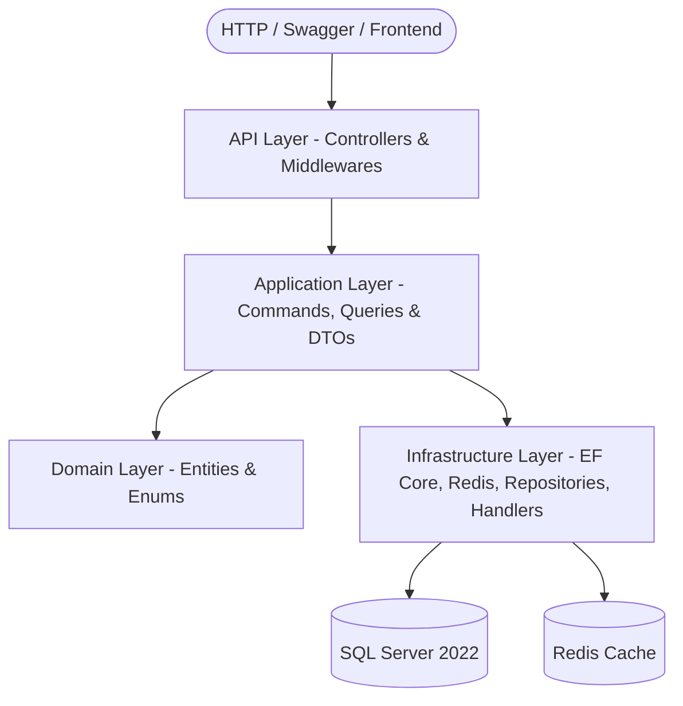
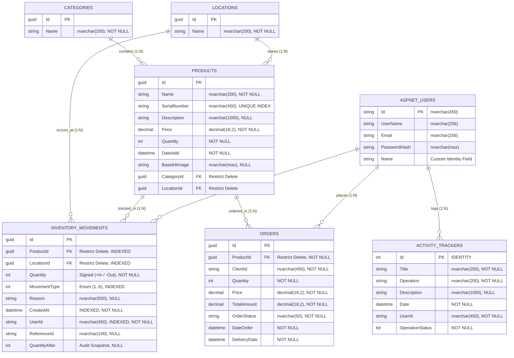

# 📦 Enterprise Inventory & Stock Management System

[](https://dotnet.microsoft.com/)
[](https://blog.cleancoder.com/)
[](https://github.com/jbogard/MediatR)
[](https://www.docker.com/)
[](https://redis.io/)
[](https://github.com/features/actions)
[](https://nunit.org/)

A robust, enterprise-grade **Inventory & Warehouse Management API** built with **C#** and **.NET 8**. Engineered following **Clean Architecture**, **CQRS (Command Query Responsibility Segregation)**, and the **Repository & Unit of Work** patterns. 

The system provides atomic stock transactions, non-repudiable audit logging, distributed caching with Redis, automated order fulfillment, multi-location warehouse tracking, and granular Role/Claim-based security.

---

## 📑 Table of Contents

- [Business Problem & Solution](#-business-problem--solution)
- [Key Features](#-key-features)
- [System Architecture](#-system-architecture)
- [Database Design & ER Diagram](#-database-design--er-diagram)
- [Tech Stack](#-tech-stack)
- [Project Structure](#-project-structure)
- [API Endpoints Catalog (39 Verified Endpoints)](#-api-endpoints-catalog-39-verified-endpoints)
- [Caching & Concurrency Strategy](#-caching--concurrency-strategy)
- [Security & RBAC](#-security--rbac)
- [DevOps & CI/CD Pipelines](#-devops--cicd-pipelines)
- [Automated Testing](#-automated-testing)
- [Getting Started](#-getting-started)

---

## 🎯 Business Problem & Solution

### The Challenge:
Traditional warehouse systems suffer from:
1. **Stock Inconsistencies & Negative Balances:** Overselling products or untracked manual quantity deductions.
2. **Lack of Audit Trails:** Inability to track who performed a stock operation, at what warehouse shelf, and why.
3. **Privilege Escalation:** Unchecked administrative operations leading to unauthorized role elevation.
4. **High Read Latency:** High load on relational databases for product lookups during peak hours.

### The Engineering Solution:
- **Signed Quantity Movement Ledger:** Every stock change is backed by an immutable `InventoryMovement` entry with `QuantityAfter`, `UserId`, `MovementType`, and optional `ReferenceId`.
- **Atomic Operations:** Stock adjustments and ledger records are bound in single atomic transactions via `IUnitOfWork`.
- **Negative Stock Prevention:** Real-time stock validation rejecting deficits before database mutation.
- **Cache-Aside Pattern:** Redis distributed caching with explicit cache invalidation on write events.
- **Defense-in-Depth Identity:** Granular Claim-Based Access Control enforcing least privilege.

---

## 🚀 Key Features

* **📦 Atomic Inventory Operations:**
  * `Stock-In`: Increases quantity, updates product state, records audit movement (+ quantity).
  * `Stock-Out`: Enforces strict stock sufficiency checks, prevents negative inventory, logs negative movement (- quantity).
* **📋 Multi-Location & Category Management:**
  * Categorize items and track physical warehouse locations/shelves (`LocationId`).
* **🛒 Order Management & Automated Stock Deduction:**
  * Automated stock deduction during order creation.
  * Comprehensive status lifecycle: `Pending` ➔ `Processing` ➔ `Delivering` ➔ `Delivered` / `Cancelled`.
* **📊 Reporting & Advanced Analytics:**
  * High-performance LINQ aggregations for monthly revenue reports.
  * Top-ordered products query and order count distributions by status.
* **🛡️ Security & Claim-Based Policies:**
  * JWT Bearer authentication.
  * 8 fine-grained authorization policies (`AdminPolicy`, `ManagerPolicy`, `CreatePolicy`, `UpdatePolicy`, `DeletePolicy`, etc.).
  * Built-in protection against privilege escalation during user registration.
* **📝 Audit & Activity Tracking:**
  * Automatic activity tracker recording user operations securely extracted from JWT identity claims.

---

## 🏗️ System Architecture

Built on **Clean Architecture** principles to achieve high testability, maintainability, and domain decoupling:



### Request Flow (MediatR Pipeline):
```
HTTP Request 
   ➔ RequestLoggingMiddleware 
   ➔ Controller 
   ➔ MediatR Command/Query 
   ➔ ValidationBehavior (FluentValidation)
   ➔ Handler (CQRS)
   ➔ Repository / Unit of Work
   ➔ SQL Server & Redis (Cache Eviction)
```

---

## 🗄️ Database Design & ER Diagram

All foreign keys are configured with `OnDelete(DeleteBehavior.Restrict)` to prevent accidental cascade deletion. The `SerialNumber` column on `Products` enforces uniqueness via a Unique Index, and `InventoryMovements` is indexed across foreign keys, movement type, creation date, and user identity.



---

## 💻 Tech Stack

| Component | Technology | Version | Purpose |
|---|---|---|---|
| **Framework** | .NET | `8.0` | Core framework |
| **API Framework** | ASP.NET Core Web API | `8.0` | RESTful API endpoints |
| **ORM** | Entity Framework Core | `8.0.28` | Data access & code-first migrations |
| **Database** | Microsoft SQL Server | `2022` | Relational database storage |
| **Messaging / CQRS** | MediatR | `12.2.0` | In-process mediator for CQRS |
| **Validation** | FluentValidation | `12.1.1` | Automatic pipeline request validation |
| **Distributed Caching**| StackExchange.Redis | `10.0.12` | High-performance memory caching |
| **Identity & Auth** | ASP.NET Core Identity + JWT | `8.0.28` | Authentication, tokens & policy claims |
| **Object Mapping** | Mapster | `10.0.11` | High-performance DTO-Entity mapping |
| **Unit Testing** | NUnit, Moq & EF InMemory | `4.6.1` | Automated test suite |
| **DevOps** | Docker & GitHub Actions | - | Containerization & automated CI/CD |

---

## 📁 Project Structure

```text
Inventory Management System/
│
├── API/                                 # Presentation Layer
│   ├── Controllers/                     # REST API Controllers (7 Controllers)
│   ├── Program.cs                       # Dependency Injection, Swagger & Pipeline Config
│   └── appsettings.json                 # Connection strings & JWT config
│
├── Application/                         # Core Application Layer
│   ├── DTO/                             # Request and Response Transfer Objects
│   │   ├── Request/                     # Input DTOs with Validators
│   │   └── Response/                    # Output / View DTOs
│   ├── Interfaces/                      # Abstractions (ICacheService, Repositories)
│   └── Services/                        # CQRS Commands and Queries
│       ├── Inventory/                   # StockIn, StockOut, Movement Queries
│       ├── Order/                       # Create, Cancel, Update, Order Queries
│       └── Product/                     # Product, Category, Location operations
│
├── Domain/                              # Enterprise Core Layer
│   └── Entities/                        # Product, Category, Location, Order, Movement, Tracker
│
├── Infrastructure/                      # External Concerns & Persistence
│   ├── Behaviors/                       # MediatR ValidationBehavior
│   ├── Caching/                         # Redis Distributed Cache Implementation
│   ├── DataAccess/                      # AppDbContext & Fluent API Configurations
│   ├── Middleware/                      # Global Exception & Logging Middlewares
│   ├── Repositories/                    # Generic & Domain-Specific Repositories
│   └── UnitOfWork/                      # Atomic Unit of Work Implementation
│
├── Testing/                             # Quality Assurance Layer
│   ├── InventoryTest/                   # StockIn, StockOut & Movement Ledger tests
│   └── ProductTest/                     # Product Handler & Validation tests
│
├── .github/workflows/                   # Automated Pipelines
│   ├── ci.yml                           # Build, Lint, Test, Coverage, Security Scan
│   └── cd.yml                           # Build Docker Image, Push to GHCR, Staging/Prod Deploy
│
├── docker-compose.yml                   # Multi-container local setup (API + MSSQL + Redis)
└── Dockerfile                           # Optimized multi-stage Docker build
```

---

## 🔌 API Endpoints Catalog (39 Verified Endpoints)

### 1. Account & Security (`/api/account`)
- `POST /api/account/login` - Authenticate user & issue JWT token.
- `POST /api/account/create` - Admin-only user creation with defense-in-depth role checks.
- `GET /api/account/users` - Retrieve system users.
- `POST /api/account/identity/setup` - Idempotent system bootstrap (initial Admin seed).
- `PUT /api/account/update-claims` - Update granular permissions and claims.
- `GET /api/account/activities` - View system activity audit log.
- `POST /api/account/activity` - Record user activity (Identity extracted from token).

### 2. Category Catalog (`/api/category`)
- `GET /api/category` - Retrieve all categories.
- `GET /api/category/{id}` - Retrieve category by ID.
- `GET /api/category/with-products` - Retrieve categories with associated products.
- `POST /api/category` - Create a new category.
- `PUT /api/category` - Update category details.
- `DELETE /api/category/{id}` - Remove category.

### 3. Inventory Operations (`/api/inventory`)
- `POST /api/inventory/stock-in` - Receive stock into location & write ledger.
- `POST /api/inventory/stock-out` - Deduct stock with balance validation.

### 4. Inventory Movements & Ledger (`/api/inventorymovement`)
- `GET /api/inventorymovement` - Filtered & paginated movements (by Product, Location, Type, User, Date).
- `GET /api/inventorymovement/{id}` - Get movement details.
- `GET /api/inventorymovement/product/{productId}` - Chronological stock movement history for a product.
- `GET /api/inventorymovement/reports/stock-in` - Filtered Stock-In report.
- `GET /api/inventorymovement/reports/stock-out` - Filtered Stock-Out report.
- `GET /api/inventorymovement/reports/adjustments` - Filtered Adjustment report.

### 5. Warehouse Locations (`/api/location`)
- `GET /api/location` - Retrieve all warehouse locations.
- `GET /api/location/{id}` - Retrieve location by ID.
- `POST /api/location` - Add warehouse location.
- `PUT /api/location` - Update location details.
- `DELETE /api/location/{id}` - Delete location.

### 6. Order Management (`/api/order`)
- `GET /api/order` - Retrieve all orders with joined product & user details.
- `GET /api/order/user/{userId}` - Retrieve orders placed by a specific user.
- `GET /api/order/count` - Aggregated status counts (Pending, Delivered, Cancelled).
- `GET /api/order/monthly` - Monthly sales revenue breakdown.
- `GET /api/order/top-ordered` - Best-selling product statistics.
- `POST /api/order` - Place order & automatically deduct stock.
- `PUT /api/order` - Update delivery date or order status.
- `PUT /api/order/cancel/{orderId}` - Cancel order.

### 7. Product Catalog (`/api/product`)
- `GET /api/product` - Get all products (Cached via Redis).
- `GET /api/product/{id}` - Get product by ID.
- `POST /api/product` - Create product & invalidate cache.
- `PUT /api/product/{id}` - Update product & invalidate cache.
- `DELETE /api/product/{id}` - Remove product & invalidate cache.

---

## ⚡ Caching & Concurrency Strategy

- **Cache-Aside Pattern:** Fast product catalog reads via Redis (`products:all`) with a 10-minute sliding TTL.
- **Targeted Invalidation:** Any mutation (`StockIn`, `StockOut`, `CreateProduct`, `UpdateProduct`) immediately purges stale cache keys:
  ```csharp
  await _cacheService.RemoveAsync("products:all");
  await _cacheService.RemoveAsync($"product:{product.Id}");
  ```
- **Cycle-Proof Serialization:** Configured with `ReferenceHandler.IgnoreCycles` to prevent cyclic reference errors during JSON serialization.

---

## 🛡️ Security & RBAC

The application implements a **Dual-Layer Authorization Architecture**:
1. **Roles:** `Admin`, `Manager`, `User`.
2. **Granular Claims:** `create`, `update`, `delete`, `read`, `MangerUser`.
3. **Privilege Escalation Protection:** The user registration endpoint enforces an immutable whitelist:
   ```csharp
   private static readonly HashSet<string> AllowedCreateRoles = new(StringComparer.OrdinalIgnoreCase)
   {
       Policy.RoleClaim.Manager,
       Policy.RoleClaim.User
   };
   // Blocks creation of Admin users through regular endpoints
   ```

---

## 🚢 DevOps & CI/CD Pipelines

### Local Multi-Container Development (`docker-compose.yml`)
Spins up the full stack in seconds with automated health checks:
- **API Container:** ASP.NET Core 8 Web API.
- **SQL Server 2022:** With automatic database health check (`SELECT 1`).
- **Redis 7:** With health ping check (`redis-cli ping`).

### Automated GitHub Actions Workflows:
1. **CI Pipeline (`ci.yml`):**
   - Triggers on every push & pull request.
   - Restores, builds, and formats code verification (`dotnet format`).
   - Runs automated NUnit tests with test container dependencies.
   - Generates code coverage reports (`Cobertura`).
   - Executes dependency security scans (`--vulnerable`).
2. **CD Pipeline (`cd.yml`):**
   - Builds optimized multi-stage Docker image.
   - Publishes image to **GitHub Container Registry (`ghcr.io`)**.
   - Automated deployment stages for `staging` and `production` (on release tag).

---

## 🧪 Automated Testing

The solution includes an automated test suite under `Testing/` using **NUnit**, **Moq**, and **EF Core InMemory Database**:
- ✅ `StockIn` increases quantity and logs positive movement.
- ✅ `StockOut` decreases quantity and logs negative movement.
- ✅ `StockOut` fails on insufficient quantity with no state alteration.
- ✅ Pagination and dynamic sorting validation for movements.
- ✅ Product validation & duplicate name prevention.

Run tests locally:
```bash
dotnet test
```

---

## 🚀 Getting Started

### Prerequisites
- [.NET 8.0 SDK](https://dotnet.microsoft.com/download/dotnet/8.0)
- [Docker Desktop](https://www.docker.com/products/docker-desktop)

### Quick Run with Docker Compose
```bash
# 1. Clone the repository
git clone https://github.com/AhmedSaye2d/InventoryManagementSystem01.git
cd InventoryManagementSystem01

# 2. Start all services (API, SQL Server, Redis)
docker compose up -d

# 3. Access Swagger UI
open http://localhost:8080/swagger
```

### Manual Local Run
1. Configure connection strings in `API/appsettings.Development.json`:
   ```json
   "ConnectionStrings": {
     "DefaultConnection": "Server=localhost;Database=InventoryDb;Trusted_Connection=True;TrustServerCertificate=True;",
     "RedisCacheUrl": "localhost:6379"
   }
   ```
2. Apply database migrations:
   ```bash
   dotnet ef database update --project Infrastructure --startup-project API
   ```
3. Run the application:
   ```bash
   dotnet run --project API
   ```
4. Navigate to `https://localhost:7147/swagger`.

---

## 📄 License
This project is licensed under the MIT License - see the [LICENSE](LICENSE) file for details.
